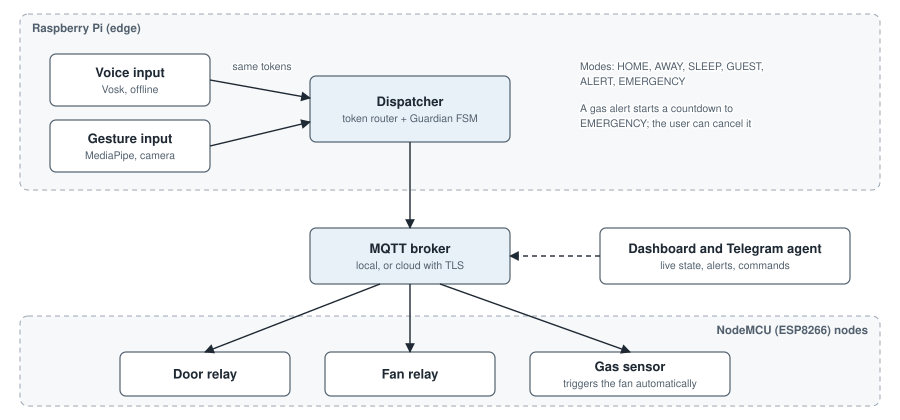

# Sentinel Edge Smart Home

An edge-first smart home built around a Raspberry Pi and NodeMCU nodes. Voice and hand gestures are recognised
**locally** (no cloud speech or vision service), turned into the same set of command tokens, and routed over MQTT
to door and fan relays and a gas sensor. A small state machine (the Guardian) reacts to gas alerts and can escalate
to an emergency mode unless the user cancels it.

Team project from my 4th year at ESI-SBA (École Supérieure en Informatique, Sidi Bel Abbès).



## What it does

- **Offline voice control**: Vosk speech recognition on the Pi, phrases normalised to canonical tokens such as `fan_on`, `mode_away`, `door_open`.
- **Gesture control**: MediaPipe Hands with a rule-based classifier, hold-frame and cooldown protection against accidental triggers.
- **One command language**: voice and gesture publish the same tokens, so the dispatcher treats them identically.
- **Guardian state machine** (`ActionRouter`): modes HOME, AWAY, SLEEP, GUEST, ALERT, EMERGENCY. A gas alert starts a 30-second countdown to EMERGENCY, which the user can cancel. See `docs/guardian_fsm.md`.
- **NodeMCU (ESP8266) firmware**: door relay and fan relay with state feedback, gas sensor with automatic fan response, MQTT command handling.
- **MQTT** over a local broker or a cloud broker with TLS; `scripts/switch_broker.sh` changes between them.
- **Web dashboard** (Flask): live MQTT stream, device state, manual commands, command history and audit trail in SQLite (`dashboard/web/README.md`).
- **Telegram agent** (Node.js + TypeScript, `smart-home-agent/`): control and alerts from a chat.
- **Test**: `tests/e2e_alert_cancel.py` simulates a gas alert and checks that cancelling works.

## Repository layout

```
hardware/raspberry-pi/    dispatcher (ActionRouter / Guardian FSM) and edge-ai publishers (voice, gesture)
hardware/mcu/             NodeMCU modular firmware, wiring and MQTT command documentation
backend/                  API and service layer (MQTT client, routing support)
dashboard/                Flask web dashboard and a static visualisation page
smart-home-agent/         Telegram bot (TypeScript)
shared/                   shared MQTT topic names
scripts/                  run, broker and flashing helpers
docker/                   docker-compose for the local stack
tests/                    end-to-end alert/cancel test
docs/                     design notes (FSM, command flow, gesture reference, integration matrix)
docs/notes/               working notes written during development (status reports, old roadmap)
```

## Quick start

1. Copy `.env.example` to `.env` and set the broker values (see Configuration below).
2. Start the dispatcher: `python hardware/raspberry-pi/dispatcher/main.py`
3. Start the voice publisher (needs a Vosk model): `python hardware/raspberry-pi/edge-ai/voice_control/voice_publisher.py`
4. Start the gesture publisher (needs a camera): `python hardware/raspberry-pi/edge-ai/gesture_control/gesture_publisher.py`
5. Optional dashboard: `python dashboard/web/server.py`, then open http://localhost:5000
6. Alert and cancel test (broker configured): `python tests/e2e_alert_cancel.py`

`scripts/run_local_stack.sh` starts the dispatcher, gesture and voice services together.

## Configuration before running

Credentials are not part of the repository. Replace the placeholders before building or running:

- `hardware/mcu/nodemcu-amica-modular/config.h`: `WIFI_SSID`, `WIFI_PASSWORD`, and for the cloud profile `MQTT_BROKER`, `MQTT_USERNAME`, `MQTT_PASSWORD`
- `dashboard/visualisation2.html`: the `YOUR_...` MQTT values near the top of the script
- Raspberry Pi services read `MQTT_USERNAME` / `MQTT_PASSWORD` from the environment (see `.env.example`)

The Vosk speech model is not included (about 40 MB). Download `vosk-model-small-en-us-0.15` from
https://alphacephei.com/vosk/models and unzip it into `hardware/raspberry-pi/edge-ai/voice_control/models/`, or set `VOSK_MODEL_PATH`.

## Voice module

- Entry point: `hardware/raspberry-pi/edge-ai/voice_control/voice_publisher.py` (source in `src/`)
- Options: `--device` and `--sample-rate` if your microphone differs from the defaults; `--verbose` for logging
- Environment: `VOSK_MODEL_PATH`, `VOICE_SAMPLE_RATE` (default 16000), `VOICE_INPUT_DEVICE`
- The module normalises many natural phrases to tokens; the full list is in the source.

## Gesture module

- Entry point: `hardware/raspberry-pi/edge-ai/gesture_control/gesture_publisher.py` (source in `src/`)
- Environment: `GESTURE_CAMERA_INDEX` (default 0), `GESTURE_HOLD_FRAMES` (default 8), `GESTURE_COOLDOWN_S` (default 2.0), `GESTURE_SHOW_PREVIEW` (`0` for a headless Pi)
- Reference: `docs/GESTURE_CHEAT_SHEET.md` and `docs/GESTURE_CONTROL_REFERENCE.md`

## Status and limits

- The gesture classifier is rule-based, with no trained model; robustness depends on lighting and camera placement.
- The voice grammar covers many phrases but may need tuning for accents and noisy rooms.
- Motion (PIR) and temperature nodes are placeholders: firmware and wiring are not tested.
- The MQTT broker credentials used during development were removed before publishing; the system has not been security-reviewed.
- No continuous integration; the only automated test is the end-to-end alert/cancel script.

## Documentation

`docs/guardian_fsm.md` (state machine), `docs/COMMAND_FLOW_AUDIT.md`, `docs/INTEGRATION_MATRIX.md`, `docs/NODE_RED_INTEGRATION.md`,
`hardware/mcu/README.md` and `hardware/raspberry-pi/SETUP_RASPI.md` (hardware), and `docs/notes/` for development notes.
