# Command Flow Audit & Implementation Status

**Last Updated**: May 31, 2026  
**Project**: Sentinel Edge Smart Home  
**Focus**: End-to-end command flow from voice/gesture → dispatcher → MCU → hardware

---

## Summary

| Stage | Total Commands | Supported | Unsupported | Status |
|-------|-----------------|-----------|-------------|--------|
| **Voice/Gesture Publishers** | 24 | 24 ✅ | 0 | ✅ All emit valid tokens |
| **Dispatcher Router** | 24 | 24 ✅ | 0 | ✅ All tokens handled |
| **MCU (MQTT Handlers)** | 24 | 24 ✅ | 0 | ✅ `home/commands` only |
| **Hardware Wiring** | 24 | 24 ✅ | 0 | ✅ Door, fan, lights, valves, indicators |

---

## Command-by-Command Audit

### ✅ FULLY IMPLEMENTED (core actuator commands)

| Command | Voice → | Gesture → | Dispatcher | MCU Handler | Hardware | Status |
|---------|----------|---------|------------|------------|----------|--------|
| **fan_on** | "turn fan on" | ☝️ Point | ✅ `home/commands` | ✅ Direct output | ✅ D0 HIGH | 🟢 Ready |
| **fan_off** | "turn fan off" | 🤏 Pinch | ✅ `home/commands` | ✅ Direct output | ✅ D0 LOW | 🟢 Ready |
| **lights_on** | "lights on" | 🖐️ Middle | ✅ `home/commands` | ✅ PWM 1023 or 400 in sleep-aware logic | ✅ D1 PWM | 🟢 Ready |
| **lights_off** | "lights off" | 🖐️ Ring | ✅ `home/commands` | ✅ PWM 0 | ✅ D1 PWM | 🟢 Ready |
| **lights_dim** | "dim lights" | 🖐️ Pinky | ✅ `home/commands` | ✅ PWM 400 | ✅ D1 PWM | 🟢 Ready |
| **lights_bright** | "bright lights" | ✌️ Victory | ✅ `home/commands` | ✅ PWM 1023 | ✅ D1 PWM | 🟢 Ready |
| **door_open** | "open door" | 🤘 Rock | ✅ `home/commands` | ✅ Servo 90° | ✅ D5 servo, D7 indicator | 🟢 Ready |
| **door_close** | "close door" | 👊🤝 Crossed | ✅ `home/commands` | ✅ Servo 0° | ✅ D5 servo, D7 indicator | 🟢 Ready |
| **mode_home** | "home mode" | 👋 Open | ✅ `home/commands` | ✅ Mode LED solid | ✅ D8 indicator | 🟢 Ready |
| **mode_away** | "away mode" | ✊ Fist | ✅ `home/commands` | ✅ Slow blink | ✅ D8 indicator | 🟢 Ready |
| **mode_sleep** | "sleep mode" | 🤲 Both | ✅ `home/commands` | ✅ Fast blink | ✅ D8 indicator | 🟢 Ready |
| **mode_guest** | "guest mode" | ✋ Two | ✅ `home/commands` | ✅ Double pulse | ✅ D8 indicator | 🟢 Ready |
| **emergency_activate** | "emergency" | 👊👊 Crossed | ✅ `home/commands` | ✅ Flash outputs, close valves, open door | ✅ All outputs | 🟡 Runtime risk |
| **emergency_cancel** | "cancel emergency" | N/A | ✅ `home/commands` | ✅ Restore home defaults | ✅ All outputs | 🟢 Ready |
| **alert_cancel** | "cancel alert" | 👍 Thumbs | ✅ `home/commands` | ✅ Reopen valves, clear alerts | ✅ D2/D6 | 🟢 Ready |
| **status_query** | "system status" | N/A | ✅ `home/commands` | ✅ Republish `home/state/*` | ✅ MQTT only | 🟢 Ready |

### ✅ Virtual-only commands

| Command | Notes |
|---------|-------|
| `windows_open_all` | Dispatcher tracks virtual state only. |
| `windows_close_all` | Dispatcher tracks virtual state only. |
| `window_open_1` | Dispatcher tracks virtual state only. |
| `window_close_1` | Dispatcher tracks virtual state only. |
| `window_open_2` | Dispatcher tracks virtual state only. |
| `window_close_2` | Dispatcher tracks virtual state only. |

---

## Current MCU MQTT Subscriptions

```cpp
TOPIC_COMMANDS = "home/commands"  ✅
```

---

## MCU Handler Implementation Status

### MqttHandlers.h

Currently handles:
```cpp
if (String(topic) == TOPIC_COMMANDS) { ... }           ✅
```

---

## Hardware Wiring Status

### ✅ Currently Wired

```
GPIO D4 (GPIO2)  → Gas sensor DO
GPIO A0 (ADC)    → Water/flood sensor AO
GPIO D5 (GPIO14) → Servo SG90 door opener
GPIO D0 (GPIO16) → Fan output
GPIO D1 (GPIO5)  → Lights PWM output
GPIO D2 (GPIO4)  → Water valve output
GPIO D6 (GPIO12) → Gas valve output
GPIO D7 (GPIO13) → Door indicator
GPIO D8 (GPIO15) → Mode indicator
```

### ❌ Not Yet Wired

```
Windows hardware  → intentionally virtual-only in the current design
```

---

## Data Flow Verification

### Test: Send "turn fan on" (voice)

```mermaid
graph LR
    A["Voice: 'turn fan on'"] 
    B["NORMALIZED: fan_on"]
    C["Publish: home/voice/command = 'fan_on'"]
    D["Dispatcher receives"]
    E["Dispatch token: fan_on"]
    F["Publish: home/commands = 'fan_on'"]
    G["MCU receives on TOPIC_COMMANDS"]
    H["Execute: D0 HIGH"]
    I["Fan output energizes"]
    J["Fan motor runs"]
    K["MCU publishes: home/state/fan = 'on'"]
    
    A --> B --> C --> D --> E --> F --> G --> H --> I --> J --> K
```



**Status**: ✅ All stages verified in code path; hardware flashing still pending

### Test: Send "open window one"

```mermaid
graph LR
    A["Voice: 'open window one'"]
    B["NORMALIZED: window_open_1"]
    C["Publish: home/voice/command = 'window_open_1'"]
    D["Dispatcher receives"]
    E["Dispatch token: window_open_1"]
    F["Dispatcher updates virtual window state only"]
    G["MCU receives?"]
    H["No hardware action by design"]
    I["State only"]
    J["Dashboard can display it"]
    
    A --> B --> C --> D --> E --> F --> G
    G --> H --> I --> J

    style H fill:#fff2cc
    style I fill:#fff2cc
    style J fill:#fff2cc
```



**Status**: 🔴 Blocked at MCU (no handler, no hardware)

---

## Recommended Priority Order

### Phase 1: Document Current State ✅ (THIS)
- [x] Catalog all commands
- [x] Trace through all stages (voice → dispatcher → MCU)
- [x] Identify gaps
- [x] Document wiring

### Phase 2: Add MCU Handlers (Next)
- [x] Add unified `home/commands` subscription
- [x] Handle fan, lights, door, modes, alerts, status query
- [x] Keep window tokens as virtual-only state in the dispatcher
- [x] Publish actuator state topics and alert topics from MCU

### Validation note

- The code path is aligned, but this audit still does not replace a physical flash-and-bench test on the ESP8266.
- The two remaining runtime-sensitive points are the exact mode-indicator timing and the emergency flash routine.

### Phase 3: Wire Hardware  
- [ ] Allocate GPIO pins for window servos (2 pins needed)
- [ ] Allocate GPIO pin for light relay
- [ ] Allocate GPIO pins for valve solenoids (2 pins)
- [ ] Create Servo/Relay classes for windows
- [ ] Create Relay classes for lights
- [ ] Update config.h with new pins
- [ ] Test each new device

### Phase 4: Integrate & Test
- [ ] End-to-end test each command
- [ ] Test all modes (home, away, sleep, guest)
- [ ] Test emergency activation
- [ ] Verify state feedback back to dispatcher

---

## Dispatcher Command Summary

All 16 command types are properly routed by the dispatcher:

```python
# Single device commands
door_open, door_close          → home/commands
fan_on, fan_off                → home/commands
lights_on, lights_off,
  lights_dim, lights_bright    → home/commands
window_open_1, window_close_1  → virtual state only
window_open_2, window_close_2  → virtual state only
windows_open_all, windows_close_all → virtual state only

# Mode commands (expand to individual commands)
mode_home    → home/commands = mode_home
mode_away    → home/commands = mode_away
mode_sleep   → home/commands = mode_sleep
mode_guest   → home/commands = mode_guest

# Safety commands
emergency_activate  → home/commands = emergency_activate
emergency_cancel    → home/commands = emergency_cancel
alert_cancel        → home/commands = alert_cancel

# Status
status_query        → republish home/state/* snapshot
```

---

## What's Working Today (May 26, 2026)

✅ Voice publisher: Emits all tokens correctly  
✅ Gesture publisher: Emits all supported tokens correctly  
✅ Dispatcher: Routes all tokens through `home/commands` or virtual state  
✅ MCU door: Receives, executes, publishes state  
✅ MCU fan: Receives, executes, publishes state  
✅ End-to-end test for door/fan: Works  

## What Needs Work

🟡 Windows: virtual-only in dispatcher  
🟡 Lights: implemented on MCU, but no separate hardware branch  
🟡 Valve indicators: implemented on MCU as valve outputs and alerts  
🟡 Status feedback: `status_query` republishes the MCU/dispatcher state snapshot  

---

## Integration Testing Checklist

- [x] Voice "turn fan on" → fan works
- [x] Voice "turn fan off" → fan stops
- [x] Voice "open door" → door unlocks
- [x] Voice "close door" → door locks
- [ ] Voice "lights on" → lights turn on (need hardware)
- [ ] Voice "open window 1" → window 1 opens (need hardware)
- [ ] Voice "home mode" → all home settings applied
- [ ] Voice "emergency" → emergency mode activated
- [ ] Gesture fan_on → fan works
- [ ] Gesture door_open → door unlocks
- [ ] Gesture lights_on → works (when hardware added)
- [ ] All modes tested with mixed voice/gesture inputs

